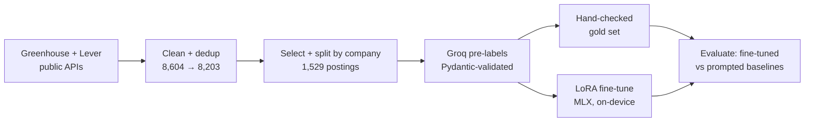

# Job Posting Extractor

[](https://github.com/HimanshAhuja/job-posting-extractor/actions/workflows/tests.yml)

Fine-tuning a small open LLM (Qwen) with **LoRA on Apple Silicon (MLX)** to turn job and internship postings into structured JSON, and **measuring whether fine-tuning actually beats prompting**.

> **Status:** Stage 1 (dataset) is nearly done; results will appear here only from real runs. Nothing below is a projected number.

## The question

Job postings bury the facts people filter on (pay, work mode, location, deadline, internship or full-time) in thousands of words of free text. A large model can pull them out with a good prompt, but it's slow and costs money per posting. **Can a 1.5B–3B model, fine-tuned on a laptop, match or beat that on postings from companies it has never seen?**

```text
{"company": "Acme", "role": "Software Engineering Intern", "job_type": "internship",
 "work_mode": "hybrid", "locations": ["Bengaluru, India"], "skills": ["Python", "SQL"],
 "start": "2027-06", "deadline": "2026-11-30", "duration_value": 6, "duration_unit": "month",
 "pay_min": 50000, "pay_max": 50000, "pay_currency": "INR", "pay_period": "month",
 "pay_raw": "₹50,000 per month", ...}
```
*(Illustrative output; the full 18-field schema is in [`src/schema.py`](src/schema.py).)*

## Pipeline



| Stage | What | Status |
|---|---|---|
| 1. Dataset | collect, clean, split, label, gold set | labelling and gold check in progress |
| 2. Baselines | prompted small Qwen (local) and large models (Groq), scored on gold | next |
| 3. Fine-tuning | LoRA on MLX, with a learning curve over training-set size | planned |
| 4. Analysis | per-field errors, where fine-tuning helps and where it doesn't | planned |
| 5. Ship | demo app and write-up | planned |

## Dataset

1,529 postings from 40 companies, split **by company** (train 1,264 / val 117 / test 148), so the test set only contains companies the model never saw. Full details are in the **[dataset card](DATASET_CARD.md)**.

## Decisions that keep the results honest

- **Split by company, not by posting.** One company's postings share templates; a random split would test the model on templates it memorised.
- **Different labeller for test.** Train is labelled by Qwen 3.8 27B (the teacher). Test is pre-labelled by gpt-oss-120b and then checked by hand, so the gold set isn't anchored on the teacher the student imitates.
- **Gold labels are human-checked:** 50 test postings in a stratified random sample, matching the test set's share of internships and India postings. Scores against model labels are reported separately and never as the headline.
- **Labels expire when their inputs change.** Each label stores a hash of the posting text and the prompt, and changing the guide or the text forces a relabel. The guide is frozen; edge cases go to [`DECISIONS.md`](DECISIONS.md).
- **Arithmetic happens in code, not in the model.** The model copies pay as written ("₹25K/month"); [`src/normalize/pay.py`](src/normalize/pay.py) turns it into yearly and monthly figures with written assumptions. Currency is never converted.
- **Free-tier aware.** Groq's daily limit refills continuously, like a token bucket. The labeller works this out from the 429 responses, waits exactly as long as needed, survives network drops without ever turning certificate checks off, and resumes from where it stopped.

## Run it

Requires Python 3.12. Fine-tuning needs an Apple Silicon Mac.

```bash
python3.12 -m venv .venv && source .venv/bin/activate
pip install -r requirements.txt
cp .env.example .env              # add your GROQ_API_KEY
python -m pytest -q               # 91 tests, no network needed

python -m src.collect.fetch_boards --all      # 1. fetch public postings
python -m src.collect.build_pool              # 2. clean + dedup
python -m src.collect.select_split            # 3. select + split by company
python -m src.label.label_groq --model qwen/qwen3.8-27b --split train --wait   # 4. pre-label
streamlit run app/review_gold.py              # 5. hand-check the gold set
```

## Repository layout

```text
src/collect/    fetch, clean, dedup, select + split
src/label/      Groq labeller, prompt, label comparison, gold-set logic
src/normalize/  pay normalization (yearly / monthly)
src/schema.py   the 18-field output schema (Pydantic)
app/            Streamlit app for hand-checking gold labels
tests/          pytest suite (runs in CI on every push)
LABELING_GUIDE.md, DECISIONS.md, DATASET_CARD.md, LEARNING.md
```

## Tech

Python 3.12 · MLX / mlx-lm · Pydantic · Groq API · Streamlit · pytest · GitHub Actions

## License

The code is MIT-licensed ([LICENSE](LICENSE)). Posting text belongs to the companies that published it and is not included in this repository.
